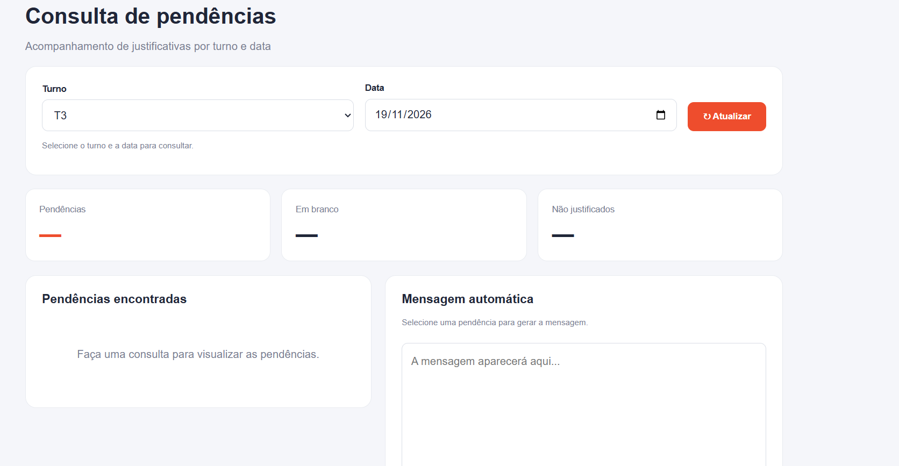

# Operational Justifications Dashboard

**Google Apps Script | Google Sheets | JavaScript | Process Automation**

I developed this web application to make it easier to track operational justifications recorded in spreadsheets.

The idea was to simplify a repetitive process: finding pending records, checking missing information, and preparing follow-up messages for the people responsible.

## What the Application Does

- Filters operational records by shift and date.
- Identifies pending justifications and missing information.
- Displays records that still require follow-up.
- Allows users to select a specific occurrence.
- Generates a standardized message requesting the missing justification.

The application combines a simple web interface with spreadsheet-based data management.

## Technologies

- **Google Apps Script:** Automation and spreadsheet integration.
- **Google Sheets:** Data organization and consultation.
- **JavaScript:** Application logic and interactions.
- **HTML & CSS:** Web interface and styling.

## Application Preview

*Illustrative interface. No real operational records or personal information are displayed.*

## Why I Built It

The main challenge was making a spreadsheet-based process easier to manage.

Instead of manually searching through records and writing similar messages repeatedly, the application brings the information together and helps prepare consistent follow-up requests.

This project gave me practical experience with workflow automation, data filtering, and interface development.

## Privacy and Confidentiality

This repository presents the project's concept and an illustrative interface.

The source code, internal spreadsheets, system identifiers, and confidential operational information are not included.

## Author

**Thales Farias**

Data Analytics | Process Automation | Business Intelligence

[GitHub](https://github.com/thalesfreirefarias)
